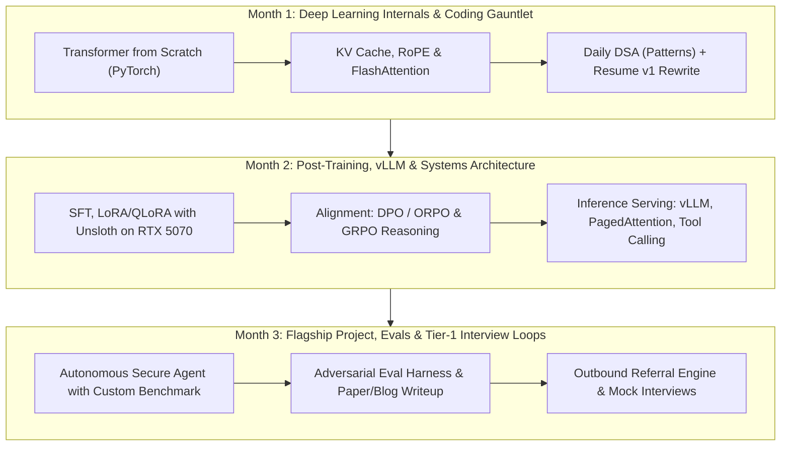

# 90-Day Masterplan: Transitioning to Tier-1 Applied AI & Post-Training Builder

**Target Profile:** Staff / Senior Applied AI Research Engineer & Agent Systems Builder  
**Niche Advantage:** Post-Training (SFT/DPO/GRPO) + Agentic Execution + Adversarial Safety & Evals  
**Time Commitment:** 30–35 hours / week (~400 total hours across 13 weeks)  
**Hardware Strategy:** Local NVIDIA RTX 5070 (12GB VRAM) for prototyping + On-Demand Cloud GPUs (RunPod/Lambda) for multi-GPU training

---

## 1. Executive Positioning Strategy

Top-tier AI labs (Anthropic, OpenAI, Scale AI, DeepMind, Mistral, Cohere, Databricks/MosaicML, Uber AI) do not hire generic "LLM wrappers" or standard enterprise IT managers. They hire engineers who can:
1. **Understand Model Internals**: Write attention, KV caches, RoPE, and custom loss functions in PyTorch without high-level abstractions.
2. **Execute Post-Training & Alignment**: Curate synthetic data, run SFT, LoRA/QLoRA, and direct alignment (DPO, KTO, or GRPO reasoning).
3. **Build High-Performance Systems**: Serve models via vLLM/SGLang, implement continuous batching, streaming tool execution, and memory management.
4. **Design Deterministic Evals**: Build reproducible harnesses with LLM-as-a-judge calibration, failure mode analysis, and adversarial stress-testing.

Your background at Oracle gives you a rare edge: **Adversarial Security + Systems Engineering + US Patent on Schema Testing**. We will reposition you not as an IT SecOps manager, but as an **AI Systems & Safety Builder** who trains and hardens autonomous agent systems.

---

## 2. Weekly Time Allocation Matrix (30+ Hours/Week)

| Time Window | Monday – Friday (3 hrs/day = 15 hrs) | Saturday – Sunday (8 hrs/day = 16 hrs) | Weekly Total |
| :--- | :--- | :--- | :--- |
| **Morning Block** (6:00 AM – 7:30 AM) | **1 hr LeetCode/DSA** + **30 min PyTorch live-coding drill** | **Deep Research & Paper Reading** (2 hrs) | ~10 hrs |
| **Evening Block** (8:30 PM – 10:00 PM) | **Core Curriculum & Code Implementation** (Deep dive topics) | **System Architecture & Systems Design** (2 hrs) | ~9.5 hrs |
| **Weekend Deep Work** (10:00 AM – 4:00 PM) | — | **Flagship Project Engineering Block** (12 hrs total) | ~12 hrs |
| **Total** | **15 Hours** | **16 Hours** | **~31 Hours** |

---

## 3. The 12-Week Execution Roadmap

---

### Month 1: Deep Learning Internals, PyTorch Live-Coding & DSA Grind
*Objective: Eliminate all rustiness in deep learning fundamentals, implement core architectures from scratch in raw PyTorch, and master technical coding patterns.*

#### Week 1: Raw PyTorch Foundations & Transformer Architecture from Scratch
- **Theory & Implementation**:
  - Implement a full decoder-only Transformer (`nanoGPT` style) in raw PyTorch from a blank file: Embedding, Multi-Head Attention (MHA), Feed-Forward Network (SwiGLU / GeLU), RMSNorm, and Residual Connections.
  - Understand tensor dimensions forward and backward: `[batch_size, seq_len, num_heads, head_dim]`.
- **Hands-On Deliverable**: Push a clean, documented, tested PyTorch implementation of a small GPT model to GitHub with training loop and loss curves on Shakespeare or TinyStories.
- **DSA Focus**: Arrays, Two-Pointers, Sliding Window (LeetCode: 11, 15, 3, 76, 239).

#### Week 2: Modern Attention, KV Cache & Positional Encodings
- **Theory & Implementation**:
  - Implement **Rotary Positional Embeddings (RoPE)** from mathematical first principles in PyTorch (complex numbers vs real 2D rotation).
  - Implement **Key-Value (KV) Cache** for autoregressive generation: track memory savings and generation latency vs full recomputation.
  - Implement **Grouped-Query Attention (GQA)** as used in Llama 3 / Qwen 2.5.
  - Contrast standard $O(N^2)$ attention with **FlashAttention** (SRAM vs HBM tiling principles, IO awareness).
- **Hands-On Deliverable**: Unit tests verifying that autoregressive generation with KV Cache outputs identical logits to non-cached forward passes, with benchmarked 5x+ speedup.
- **DSA Focus**: Stacks, Queues, Linked Lists, Fast & Slow Pointers (LeetCode: 20, 155, 739, 146 LRU Cache - *crucial for systems interviews*).

#### Week 3: Backpropagation, Optimization & Training Dynamics
- **Theory & Implementation**:
  - Implement cross-entropy loss from scratch with numerical stability tricks (`log-sum-exp`).
  - Implement **AdamW optimizer** from scratch (momentum, variance, bias correction, weight decay decoupling).
  - Learning rate schedules (warmup + cosine decay) and gradient clipping.
  - Mixed precision training mechanics (FP32, FP16, BF16, FP8, dynamic loss scaling).
- **Hands-On Deliverable**: A custom training engine running on your RTX 5070 benchmarking FP32 vs BF16 training throughput and VRAM footprint.
- **DSA Focus**: Trees, Binary Search, Heaps/Priority Queues (LeetCode: 104, 236, 295, 33, 4).

#### Week 4: Tokenizers, Data Pipelines & Resume Modernization
- **Theory & Implementation**:
  - Byte-Pair Encoding (BPE) from scratch: tokenization, vocabulary building, merge tables, special tokens (`<|im_start|>`, `<|im_end|>`).
  - High-throughput PyTorch `DataLoader` with dynamic padding, packing (concatenating sequences to avoid waste), and memory pinning.
- **Career Deliverable**:
  - Finalize **Revamped 1-Page Resume**: Strip CEH, ITIL, legacy IT/vendor bullets. Reposition Oracle experience to "Lead AI Systems & Security Engineer".
  - Optimize LinkedIn profile: Banner, headline, featured GitHub repos, clear signal as an AI Systems/Post-Training builder.
- **DSA Focus**: Graphs (BFS, DFS, Dijkstra, Topological Sort) (LeetCode: 200, 133, 207, 210, 743).

---

### Month 2: Post-Training (SFT/DPO/GRPO), vLLM & Systems Architecture
*Objective: Master parameter-efficient fine-tuning, post-training alignment, high-throughput inference serving, and launch the flagship project.*

#### Week 5: Parameter-Efficient Fine-Tuning (PEFT) on RTX 5070
- **Theory & Implementation**:
  - **LoRA (Low-Rank Adaptation)**: Mathematical derivation ($W + \frac{\alpha}{r}BA$), rank selection, initialization tricks ($A \sim \mathcal{N}(0, \sigma^2)$, $B=0$), target modules (`q_proj`, `v_proj`, `gate_proj`).
  - **QLoRA (4-bit Quantization)**: NF4 data type, double quantization, paged optimizers.
  - Tooling: Master **Unsloth** and **Hugging Face PEFT/TRL**.
- **Hands-On Deliverable**: Fine-tune Qwen 2.5-Coder 7B or Llama 3.1 8B on your RTX 5070 (12GB VRAM) using QLoRA 4-bit with 0 OOM errors. Measure memory vs rank $r \in [8, 16, 32, 64]$.
- **DSA Focus**: Dynamic Programming (1D & 2D) (LeetCode: 70, 322, 300, 1143, 72).

#### Week 6: Alignment & Post-Training (DPO, ORPO, GRPO)
- **Theory & Implementation**:
  - The evolution of alignment: Why RLHF (PPO) was replaced by **DPO (Direct Preference Optimization)**; implicit reward modeling.
  - Implement DPO loss function in PyTorch:
    $$\mathcal{L}_{\text{DPO}}(\pi_\theta; \pi_{\text{ref}}) = -\mathbb{E}_{(x, y_w, y_l)}\left[\log \sigma\left(\beta \log \frac{\pi_\theta(y_w|x)}{\pi_{\text{ref}}(y_w|x)} - \beta \log \frac{\pi_\theta(y_l|x)}{\pi_{\text{ref}}(y_l|x)}\right)\right]$$
  - Understand **GRPO (Group Relative Policy Optimization)** and Rule-Based Reinforcement Learning (RLVR) used in DeepSeek-R1 for reasoning models without a critic network.
- **Hands-On Deliverable**: Run a DPO alignment experiment comparing base vs aligned model on synthetic preference data.
- **DSA Focus**: Backtracking & Recursion (LeetCode: 46, 78, 51 N-Queens, 79).

#### Week 7: High-Throughput Inference Engines (vLLM & SGLang)
- **Theory & Implementation**:
  - **PagedAttention**: Operating system virtual memory concepts applied to KV cache allocation to eliminate fragmentation.
  - **Continuous Batching (Iteration-Level Scheduling)** vs static batching.
  - Quantization techniques for serving: AWQ vs GPTQ vs GGUF.
  - Speculative Decoding (draft model vs target model verification).
- **Hands-On Deliverable**: Deploy an OpenAI-compatible vLLM server locally on your RTX 5070; benchmark tokens-per-second, TTFT (Time to First Token), and ITL (Inter-Token Latency) under concurrent loads using `locust` or `ghz`.
- **System Design Focus**: Design an enterprise LLM gateway with rate-limiting, semantic caching, fallback routing, and token budget management.

#### Week 8: Flagship Project Phase 1 — Dataset Curation & Model Training
- **Project: *AEGIS-Agent* (Adversarially-Hardened Autonomous Reasoning & Code Review System)**
  - Synthetic Data Engine: Generate a high-quality dataset of 5,000+ vulnerability triage, patch verification, and adversarial jailbreak pairs using Claude 3.5 Sonnet / GPT-4o as teacher models.
  - Clean and filter: Deduplication via min-hash embeddings, format verification, and quality rubric filters.
  - Model Training: Fine-tune Qwen 2.5-Coder 7B via SFT + DPO to reason step-by-step (`<thought>` tags) and identify subtle security bugs and injection payloads without yielding to evasion attacks.
- **Hands-On Deliverable**: Model weights published on Hugging Face Model Hub with full training logs on Weights & Biases (W&B).
- **DSA Focus**: Advanced Graphs & Disjoint Set / Union-Find (LeetCode: 684, 547, 802).

---

### Month 3: Flagship Project Phase 2, Evals & Tier-1 Outbound Loops
*Objective: Build an industrial-grade agent harness, design a reproducible eval benchmark, master ML system design, and run targeted outreach.*

#### Week 9: Flagship Project Phase 2 — Agent Harness & Sandboxing
- **Architecture**:
  - Build an autonomous execution loop with tool calling: static analyzer inspection, git diff patch verification, and dynamic execution in an isolated Docker container.
  - Integrate defensive hardening: Context integrity checks, tool parameter validation, and prompt injection detection layer.
  - Low-latency streaming: Stream partial reasoning tokens to the client while parallelizing tool pre-fetching.
- **Hands-On Deliverable**: A production-ready Python repository with Docker Compose setup, comprehensive pytest coverage (>85%), and GitHub Actions CI.
- **ML System Design Focus**: Design a real-time AI code review system handling 100k PRs/day with deterministic SLA and safety guarantees.

#### Week 10: Flagship Project Phase 3 — Deterministic Eval Benchmark
- **The Core Differentiator for Research Labs**:
  - Build a custom evaluation harness modeled after SWE-bench and CyberSecEval.
  - Create 100 challenging, curated evaluation tasks with ground-truth unit tests and adversarial traps (e.g. prompt injections hidden inside comments or commit messages).
  - Benchmark your fine-tuned model against base models (Llama 3.1 8B, Qwen 2.5 7B, Mistral 7B, GPT-4o-mini).
- **Publish & Distribute**:
  - Write an in-depth technical report / engineering blog post: *"How We Fine-Tuned Qwen 2.5-Coder with DPO to Defend Against Autonomous Agent Injection Attacks: Architecture, Loss Dynamics, and Failure Analysis"*.
  - Share on Twitter/X, Hacker News, and LinkedIn.
- **DSA Focus**: High-Frequency Interview Problems & Timed Mock Assessments.

#### Week 11: ML Systems Design & Research Interview Drills
- **Core Topics Mastered**:
  1. Distributed Training: Data Parallelism (DDP), ZeRO 1/2/3 (DeepSpeed/FSDP), Tensor Parallelism (Megatron-LM), Pipeline Parallelism.
  2. Large-scale RAG vs Long-Context Models: Chunking, hybrid BM25 + dense retrieval, re-ranking (Cross-Encoders), lost-in-the-middle phenomena.
  3. LLM Safety & Red-Teaming Systems: Automated red-teaming architectures, jailbreak taxonomy (GCG, PAIR, TAP, multi-turn persuasion), guardrail latency tradeoffs.
  4. Agent State & Memory: Episodic memory, semantic summarization, reflection loops, checkpointing, and cycle detection.
- **Drill**: 3 full mock interviews (1 DSA, 1 PyTorch live-coding, 1 ML System Design) with peers or via platforms like Pramp / interviewing.io.

#### Week 12: Targeted Outbound, Warm Referrals & Interview Gauntlet
- **The Reverse Sourcing Engine**:
  - Do NOT apply via cold web portals.
  - Identify 25 target companies (Anthropic Safety/Applied, Scale AI, Databricks MosaicML, Mistral, Uber AI, Lakera, Protect AI, Sarvam AI, Google DeepMind/Research India, Microsoft GenAI).
  - Find the exact Engineering Managers, Staff Engineers, and Tech Leads building these systems.
  - Send high-signal, personalized outbound messages referencing your open-source repo, benchmark results, and patent.
  - Activate alumni network (Manipal, Oracle, JPMC, Pramati).
- **Execution**: Target 5-8 live interview loops, negotiate offers, and transition out of enterprise SecOps management into core AI engineering.

---

## 4. RTX 5070 (12GB) + Cloud Hybrid Compute Blueprint

You do **not** need a \$10,000 server to do serious work if you set up your environment correctly:

| Workload | Hardware Environment | Stack / Tools | Monthly Cost |
| :--- | :--- | :--- | :--- |
| **Transformer Coding & PyTorch Drills** | Local PC (RTX 5070) | PyTorch 2.5+, CUDA 12.x, VS Code | \$0 |
| **Base Model Exploration & Inference** | Local PC (RTX 5070) | vLLM / Ollama, AWQ 4-bit, GGUF | \$0 |
| **PEFT / QLoRA 4-bit (7B/8B Models)** | Local PC (RTX 5070) | Unsloth, Hugging Face TRL | \$0 |
| **DPO / Full 16-bit LoRA (8B Models)** | Cloud On-Demand (RunPod / Lambda) | 1x NVIDIA A100 (80GB) or L40S | ~\$20–\$40 total (run for 5–10 hrs) |
| **Multi-GPU Distributed Eval / Sweeps** | Cloud On-Demand (RunPod) | 2x A100 (80GB) with FSDP/vLLM | ~\$30–\$50 total |

> [!TIP]
> **Use Unsloth on your RTX 5070**: Unsloth bypasses standard PyTorch memory bottlenecks by rewriting forward and backward kernels in Triton, reducing VRAM usage by up to 80% and speeding up training by 2–5x. You can train Llama-3-8B with a 4k context window on an 8GB VRAM card; on your 12GB RTX 5070, it will fly.

---

## 5. Typical Top-Tier Interview Loop & How You Win

### Key Technical Questions You Must Answer Cold:
1. **PyTorch**: *"Implement Multi-Head Attention without using `nn.MultiheadAttention`. Show where transposition happens and why."*
2. **Systems**: *"Given an 8B parameter model in FP16, how much VRAM is required for weights, gradients, optimizer states (AdamW), and activation memory for batch size 4 and seq len 4096?"*
   - *Answer*: Weights = $8 \times 2 = 16\text{ GB}$. Gradients = $16\text{ GB}$. AdamW (fp32 master weights + momentum + variance) = $8 \times 4 \times 3 = 96\text{ GB}$. Total for training without ZeRO = $\sim 128\text{ GB}$ (hence why ZeRO/FSDP or LoRA is mandatory).
3. **Alignment**: *"Why does DPO sometimes cause model collapse or degenerate outputs (length bias), and how do ORPO, SimPO, or length-normalized DPO mitigate this?"*
4. **Safety & Evals**: *"How would you detect and defend against a confused-deputy attack where an untrusted codebase injects hidden instructions into an agent's memory via dynamic tool output?"*
